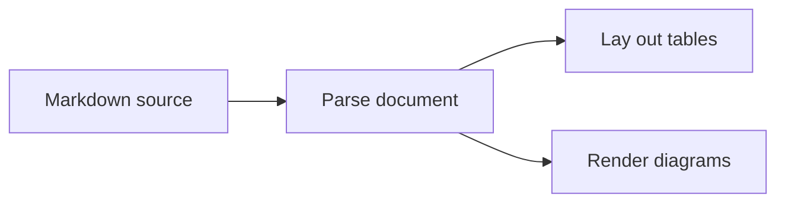

# Slate

A small native desktop editor for Linux and macOS. Open a folder to browse its files in the left pane, or pass a file to open it directly. The C++20 document engine opens multi-gigabyte files without building a full text buffer or a line index. The compact menu bar groups file, edit, selection, search, and view commands above the document tab. Markdown opens as a formatted document with a one-click switch to the source editor.

## Build and run

Slate requires GTK 3.24 and Pango 1.50 or later. On Debian or Ubuntu, install the development tools and GTK headers.

```sh
sudo apt install build-essential cmake pkg-config libgtk-3-dev
```

On macOS, install the Xcode command-line tools and the GTK dependency through Homebrew. [Homebrew GTK 3 formula](https://formulae.brew.sh/formula/gtk%2B3)

```sh
xcode-select --install  # if the command-line tools are missing
brew install cmake pkgconf gtk+3
```

Build and run from this directory. The default build is optimized.

```sh
cmake -S . -B build -DCMAKE_BUILD_TYPE=Release
cmake --build build --parallel
./build/slate .            # browse this directory
./build/slate README.md    # read or edit Markdown
```

Install Slate and its Mermaid renderer for your user account. The second command downloads the platform-specific Merman CLI and verifies its SHA-256 checksum. On Linux the first command also installs the **Slate** desktop launcher.

```sh
cmake --install build --prefix "$HOME/.local"
sh packaging/install-mermaid.sh
```

## Editing and search

| Action | Shortcut or gesture |
| --- | --- |
| Open file / open folder | Ctrl+O / Ctrl+Shift+O |
| New file / save / save as | Ctrl+N / Ctrl+S / Ctrl+Shift+S |
| Find a file by name or relative path | Ctrl+P |
| Find exact text in files on disk | Ctrl+Shift+F |
| Select / extend selection / select a word | Drag / Shift+click / double-click |
| Copy / cut / paste / select all | Ctrl+C / Ctrl+X / Ctrl+V / Ctrl+A |
| Undo / redo | Ctrl+Z / Ctrl+Shift+Z |
| Toggle Markdown Source / Preview | Ctrl+Shift+M |
| Jump to the start / end of the document | Ctrl+Home / Ctrl+End |
| Close the window | Ctrl+W |

Right-click a selection for the edit menu. Use Command for the primary shortcuts on macOS. In the sidebar, press Enter to open the first search result or click a result to select it. Content hits select the matching bytes. Escape in the search field clears the query and restores the directory tree. Use the refresh button to pick up filesystem changes.

Open **Edit → Appearance…** with **Ctrl+,** on Linux or **Command+,** on macOS. Choose Dark or Light and adjust the document background, panels, text, secondary text, accents, or code color. Changes preview immediately. **Save** remembers the colors for each mode, and **Cancel** restores the previous appearance.

## Markdown

Open a `.md` or `.markdown` file to read it. Use **Source** to edit and **Preview** to see the current unsaved text. Both controls sit on the tab strip. Choosing a content-search result opens Source with the matching bytes selected.

The native preview renders headings, nested lists, block quotes, code blocks and spans, emphasis, links, images, thematic breaks, tables, strikethrough, and task lists. Relative Markdown links open in Slate, and heading links jump within the rendered page. Local PNG and JPEG images render inline within decode and display budgets. Other images show their alternative text. Raw HTML appears as source. The C parser is bundled with its license, so building the preview needs no network download. [MD4C](https://github.com/mity/md4c)

Ordinary documents render in full. Files over 1 MiB and unusually dense or long-line inputs use **Previous page** and **Next page** controls to bound memory and layout time. Source mode always covers the entire file. Switching from Source to Preview opens the page containing the caret. A page is parsed independently, so a fence, reference definition, or heading on another page may affect formatting at the boundary.

### Tables and Mermaid diagrams

Tables have aligned columns, grid lines, a shaded header, selectable text, and wrapping within cells. Wide tables scroll horizontally. Mermaid diagrams use a transparent canvas and follow the active palette. Use a fenced block labeled `mermaid` to embed a diagram.



To render diagrams, install [Merman CLI 0.11.0](https://github.com/Latias94/merman/releases/tag/v0.11.0) for Linux or macOS. Slate looks for `merman-cli` on your path. Set `SLATE_MERMAN` to use a particular executable. The native helper renders offline while the surrounding text is already available. It exits after each diagram, and Slate reuses rendered diagrams from a 4 MiB cache. If the renderer is unavailable or the Mermaid syntax is invalid, expand the diagram in Preview to read or copy its source.

## Architecture and memory

| Component | Design |
| --- | --- |
| Document storage | One open file descriptor and a 64-bit AVL piece tree. Leaves reference offsets into the original file or reference-counted 64 KiB edit blocks. Splitting and joining pieces changes the logical text without shifting the file suffix. Contiguous typing coalesces. Unreferenced edit blocks are released. |
| Disk reads | Positional reads with a lazy eight-slot, 64 KiB page cache for small requests. Large reads go directly to the caller's buffer. Opening a document needs metadata and one tree leaf. |
| Viewport | Cairo draws the selection, caret, gutter, and visible Pango layouts. The scrollbar uses byte offsets. Distant seeks show hexadecimal byte addresses in the gutter until a line number is known. The viewport splits very long physical lines into bounded display segments. |
| Markdown preview | A cancellable worker reads a shared document snapshot, parses Markdown, prepares style runs, and decodes bounded local images. GTK displays native selectable text using a fixed set of reusable tags. Plain-text editing initializes no preview widgets. Mermaid blocks launch a short-lived native renderer only on a cache miss. |
| Directory browser | Folders load on expansion in pages of 128 entries. Collapsing a folder releases its rows. Only loaded pages are sorted. There is no persistent workspace index. |
| Search | A cancellable worker uses native directory entries, checks metadata when the filesystem omits the entry type, skips symlinks, and returns up to 200 results. It opens content candidates relative to their directory descriptor. Filename matching uses ASCII case folding on relative paths. Content matching uses native `memmem` on 256 KiB blocks with overlap for boundary matches. Supported filesystems let the scanner skip sparse holes for text queries. |
| Save | A worker takes a shared snapshot, streams the edited bytes to a sibling temporary file, flushes it, checks for external changes, and renames it over the destination. Edits pause until the save completes. Existing targets retain their ordinary permission bits. New files start private (0600). |

The document engine uses memory proportional to the live edit blocks, piece metadata, and bounded read caches. The UI also uses memory for visible text, explicitly expanded tree pages, clipboard data, and history. A cold content search must read the matching scope from storage. Saving a changed dense file needs time and temporary disk space proportional to the output size.

Undo retains up to 8 MiB of edit records. An edit larger than that budget clears the history. Clipboard operations accept up to 16 MiB of UTF-8 text per transfer. GTK may receive a larger external paste before Slate can reject it. Workspace searches read the saved bytes on disk, so save current edits to include them in results. Atomic replacement creates a new inode. Extended attributes, ACLs, and hard-link relationships are lost on replacement.

## Verification

```sh
ctest --test-dir build --output-on-failure
cmake --build build --target slate_bench
./build/slate_bench
```

The benchmark creates and removes a temporary 1 GiB dense log file and 50,000 directory entries. Pass a size in GiB to change the workload, for example `./build/slate_bench 5`. Allow about 2.1 GiB of free disk space for the default workload, or just over twice the requested file size. It reports warm-cache timings and peak resident memory for the standalone engine process.

Tests cover randomized document edits, snapshot saves, modified files on disk, UTF-8 and CRLF segment boundaries, 64-bit offsets, and sparse files over 5 GiB. On Linux, install `xvfb`, `xauth`, `xdotool`, and Python 3 before configuring to include an end-to-end desktop test. It copies rendered text through the menu, switches to Source, types into the window, opens search results, and edits and saves beyond 5 GiB. Renderer tests exercise semantic tags, images, links, current edits, cancellation, and the final page of a file beyond 5 GiB. The included CI workflow builds and runs the applicable tests on Linux and macOS.

## Measured performance

Release build, Clang 18, Ryzen 9 9950X3D, Linux x86-64, NVMe/ext4. These are single warm-cache runs. The GUI test used GTK 3.24.41 on Xvfb. RSS includes the process's resident shared-library pages and excludes the filesystem page cache.

| Workload | Result |
| --- | ---: |
| Launch window on 5 GiB dense log, with 50,000 other files in the folder | 92 ms to mapped window |
| Peak GUI RSS after opening the dense log and jumping to EOF | 41.2 MiB |
| Peak GUI RSS for a 5 GiB sparse file with a single very long line | 42.2 MiB |
| Engine open and first 16 KiB read, dense 5 GiB log | 0.053 ms |
| 10,000 one-byte inserts at scattered offsets | 9.6 ms total |
| Complete filename search over 50,000 entries | 6.0 ms |
| Content search finding a literal at the end of a dense 5 GiB log | 294 ms |
| Atomic save of the edited dense 5 GiB log | 1.52 s |
| Peak RSS in the standalone storage/search benchmark | 8.4 MiB |

Reproduce the engine and desktop workloads with the commands below. The window measurement launches each file in a fresh process and samples its Linux peak RSS after a jump to EOF.

```sh
./build/slate_bench 5
xvfb-run -a python3 benchmarks/window_memory.py build/slate
```

## Rendering and interaction benchmarks

The following measurements use the same Linux machine and a warm filesystem cache. The preview benchmark starts with its GTK window mapped. **First paint** measures the first draw containing formatted text. **Ready** measures completion of text and style insertion for the displayed document or page. The values are medians of seven loads per fixture. RSS is the peak for the standalone preview harness including GTK.

| Markdown source | First paint | Ready | Peak RSS |
| --- | ---: | ---: | ---: |
| 8 KiB formatted guide, entire document | 16.5 ms | 1.1 ms | 35.0 MiB |
| 512 KiB table- and list-heavy manual, displayed page | 12.5 ms | 17.3 ms | 36.1 MiB |
| 1 MiB of short emphasized list items, displayed page | 16.3 ms | 1.9 ms | 33.9 MiB |
| 1,000 KiB unbroken line, displayed page | 15.2 ms | 1.0 ms | 33.3 MiB |
| 5 GiB sparse Markdown, alternating first and last pages | 17.5 ms | 0.8 ms | 35.2 MiB |

Releasing a displayed page took under 1 ms on these fixtures. None contained Mermaid diagrams. For diagrams, the native renderer uses additional memory until it exits. The full desktop process peaked at 42.0 MiB when opening a small Markdown file in a folder with 50,000 entries.

For source editing, a warm one-row scroll beyond offset 5 GiB with 768-byte rows took 0.42 ms to lay out and paint (0.45 ms at p95). Reusing already-shaped rows reduced this from 2.20 ms. A second ASCII shaping experiment gained under 2% in painted frames and was dropped. Filename search across a nested 50,000-file fixture fell from 55.4 to 5.7 ms after eliminating per-file metadata calls on ext4. A subsequent substring-matching experiment yielded little further improvement.

```sh
cmake --build build --target slate_preview_bench slate_markdown_bench slate_scroll_bench
./build/slate_markdown_bench
xvfb-run -a ./build/slate_scroll_bench
xvfb-run -a ./build/slate_preview_bench guide 7
```

The preview benchmark also accepts `manual`, `dense`, `line`, and `sparse`. On a graphical macOS session, run the GTK benchmarks directly.
